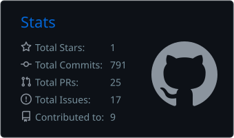

<a href="https://js195.co.uk"><b>Website</b></a> ·
<a href="https://js195.co.uk/#projects">Projects</a> ·
<a href="https://www.linkedin.com/in/joshua-smith-487846181/">LinkedIn</a> ·
<a href="mailto:js-195@outlook.com">Email</a>

 

 

> I build reliable systems for data-intensive and quantitative problems:
> from high-volume market-data pipelines to scientific-computing and optimisation tools.

## 🖥️ Running right now

The site isn't hosted on a cloud platform. It's a **Linux box in my home**, serving [js195.co.uk](https://js195.co.uk) through a Cloudflare Tunnel, with a live dashboard of its uptime, CPU temperature and latency. The badge above pings it for real.

## Selected work

| | |
|---|---|
| **[Ancestree](https://github.com/JS195/ancestree)** | Dependency-free data lineage and reproducibility tooling for Python and SQL. [Try the interactive demo →](https://js195.co.uk/#projects) |
| **[Crypto order flow](https://github.com/JS195/orderflow-alpha)** | A Parquet-backed market-data archive collecting ~11.5M rows/day across ten venues. |
| **[Home server](https://github.com/js-home-server)** | Docker and Linux infrastructure behind [js195.co.uk](https://js195.co.uk). |
| **[ASCII art renderer](https://github.com/JS195/asciiArt)** | A fast C renderer for monochrome, greyscale and colour ASCII output (yes, that's why the banner looks like that). |

Full write-ups and case studies live on **[js195.co.uk](https://js195.co.uk)**.

`data engineering` · `quantitative research` · `optimisation` · `scientific computing` · `high-performance Python`

